# KaizenFlow — Digital twin logistics cho nhà máy

**DENSO Factory Hacks 2026 · Đề D2 — Simulate & Forecast Logistics, Recommend Actions**

KaizenFlow dựng một bản sao số (digital twin) của luồng logistics trong nhà máy: kho, máy, lắp ráp, kiểm tra, đóng gói, cửa xuất và đội xe (xe kéo, AGV, AMR). Hệ thống làm ba việc rồi đưa ra hành động:

- **Predict**: mô phỏng Monte Carlo cho biết kho nào sẽ chuyển Đỏ, với xác suất bao nhiêu và vào lúc nào; dự báo từ trạng thái thật đang chạy (30 phút đến 1 tuần).
- **Detect**: chỉ ra điểm nghẽn, và cảnh báo khi số thật lệch khỏi dải dự báo.
- **Simulate**: chạy what-if (máy hỏng theo RUL, thiếu xe, rút kho…), rồi **đề xuất** 3 hành động đã được chạy thử, kèm số phút Đỏ giảm được. Áp dụng một đề xuất thì hệ thống chạy lại, so trước/sau và in báo cáo.

Nó trả lời bốn vấn đề thấy ở buổi tham quan nhà máy:

| Vấn đề | KaizenFlow làm gì |
|---|---|
| Bảo trì dự đoán thiếu dữ liệu lỗi để huấn luyện | Tiêm lỗi theo đường cong P-F vào mô phỏng, xuất dữ liệu cảm biến tổng hợp **có nhãn** (`label_fault`, `rul_s`) |
| Bảng kho Xanh/Vàng/Đỏ chỉ biết khi đã Đỏ | Báo trước kho nào chuyển Đỏ, xác suất và thời điểm, cùng hành động để tránh |
| Xe kéo chờ người móc hàng, tuyến AGV dễ tắc | Mô phỏng đội xe, người móc kéo và bản đồ AGV/AMR (chặn làn thì xe đi vòng, có pin và chỗ sạc) |
| Máy cũ không có PLC, không lấy được số liệu | Camera đọc đồng hồ kim/số ở edge, số đọc đi thẳng vào twin như một nguồn dữ liệu |

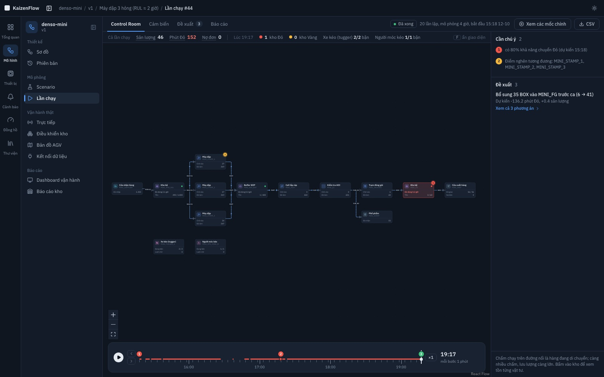

> Tham số thiết bị trong các mô hình demo là **giả định** (đánh dấu `assumed`), không phải dữ liệu DENSO. Ảnh mặt bằng là bản vẽ mẫu.

## Mục lục

1. [Chạy nhanh bằng Docker](#1-chạy-nhanh-bằng-docker)
2. [Kiến trúc hệ thống](#2-kiến-trúc-hệ-thống)
3. [Luồng dữ liệu](#3-luồng-dữ-liệu)
4. [Ảnh chụp kết quả](#4-ảnh-chụp-kết-quả)
5. [Chi tiết tính năng](#5-chi-tiết-tính-năng)
6. [Phát triển và kiểm thử](#6-phát-triển-và-kiểm-thử)

## 1. Chạy nhanh bằng Docker

**Cần có:** Docker Desktop hoặc Docker Engine có Compose v2 (`docker compose`), cấp cho Docker từ 6 GB RAM; Python 3 để chạy script nạp dữ liệu (chỉ dùng thư viện chuẩn). Không cần cài Node, Go hay thư viện Python nào khác. Các cổng phải còn trống:

| Cổng | Dịch vụ |
|---|---|
| **8088** | Giao diện web |
| 8080 | API (Go) |
| 8081 | sim: mô phỏng |
| 8090 | feed: bộ phát dữ liệu giả lập |
| 5433 | PostgreSQL + TimescaleDB |

```bash
git clone https://github.com/StrongDZ/KaizenFlow.git
cd KaizenFlow
docker compose up -d --build          # lần đầu mất vài phút để build image
python3 scripts/seed_demo.py          # khai thiết bị, dựng 4 mô hình demo, scenario và bản đồ AGV
python3 scripts/seed_video_demo.py    # tuỳ chọn: bản đồ trên ảnh mặt bằng, 3 nhà máy phụ, thêm scenario
```

Mở **http://localhost:8088**. Hai script nạp dữ liệu chạy lại bao nhiêu lần cũng được. Repo đang để private: cần được cấp quyền đọc, hoặc giải nén bản mã nguồn đã nộp rồi chạy từ lệnh `docker compose`.

Kiểm tra nhanh: `docker compose ps` phải thấy `db` ở trạng thái healthy và các service khác đang chạy; `curl localhost:8080/api/health` trả `{"status":"ok"}`.

Các mô hình demo do `seed_demo.py` dựng:

| Mô hình | Là gì |
|---|---|
| `denso-mini` | Dây chuyền thẳng: kho NVL → 3 máy dập → lắp ráp → AOI → đóng gói → kho thành phẩm → xuất, có xe kéo và người móc kéo |
| `denso-plant` | 2 kho NVL nuôi 4 máy dập, 2 buffer WIP dùng chung, 2 kho thành phẩm nối chéo 2 cửa xuất |
| `denso-plant-amr` | Như `denso-plant` (dùng chung thiết bị), nhưng đội xe kho B là AMR có pin và chỗ sạc |
| `plant-5000m2` | Mặt bằng 5000 m² có ảnh nền |

### Thử trong 10 phút

**Mô phỏng và đề xuất (Predict → Detect → Simulate → Recommend)**

1. Mục **Thiết bị**: danh mục máy thật của nhà máy. Cột "Dùng trong" cho biết một máy nằm trong những mô hình nào.
2. Mục **Mô hình** → `denso-mini` → **Sơ đồ**: workflow dạng node/edge, được kiểm tra tự động theo 18 luật sau mỗi lần sửa.
3. **Scenario** → "Máy dập 3 hỏng (RUL ≈ 2 giờ)" → **Chạy** (20 lần lặp Monte Carlo, khoảng 10 giây).
4. **Control Room** của lần chạy: bấm phát lại để thấy kho thành phẩm chuyển Đỏ; bên phải có cảnh báo "có X% khả năng chuyển Đỏ lúc …" và điểm nghẽn. Tab **Cảm biến** cho thấy độ rung của máy dập 3 tăng dần, kèm nhãn lỗi; nút **CSV** tải dữ liệu có nhãn để huấn luyện bảo trì dự đoán.
5. Tab **Đề xuất**: 3 hành động đã chạy thử, kèm KPI trước/sau. Bấm **Áp dụng và chạy lại**, rồi mở **So với lần chạy gốc**.
6. Tab **Báo cáo** → **In / Lưu PDF**.

**Vận hành thật (live twin)**

7. Mô hình `denso-plant` → **Trực tiếp** → **Bắt đầu phát dữ liệu giả lập** (chọn ×60). Feed đóng vai nhà máy thật và cố ý lệch khỏi mô hình (chu kỳ máy ×1,10, nhu cầu ×1,08).
8. Các thiết bị hiện ra ở **Thiết bị → Nguồn dữ liệu**. Về mô hình, mở **Kết nối dữ liệu** → **Gợi ý ghép tự động** → **Áp dụng**; ô nào còn thiếu thì dùng gợi ý tự tính.
9. Quay lại **Trực tiếp**: sơ đồ đổi màu và số theo dữ liệu thật. Bấm **Dự báo từ bây giờ** (1 ngày). Bấm **Bơm sự cố** trên thanh feed → "Máy hỏng", rồi xem kho đổi màu và **Cảnh báo lệch dự báo**.
10. **Bản đồ AGV**: xe chạy theo làn. Bấm một làn → **Chặn đường này 30 phút (demo)** để thấy xe dồn lại hoặc đi vòng. Cuộn xuống **Hiệu chỉnh thời gian chuyến** để đưa thời gian chuyến đo được vào mô hình dự báo.

### Khi gặp sự cố

- **Cổng bị chiếm**: đổi cổng web bằng `WEB_PORT=9000 docker compose up -d`. Cổng feed (8090) chỉ để gỡ lỗi, có thể bỏ bằng một file override (`services: { feed: { ports: !reset [] } }`).
- **Docker thiếu RAM khi dự báo dài**: giảm `SIM_WORKERS` của service `sim` trong `docker-compose.yml`.
- **Muốn làm sạch dữ liệu**: `docker compose down -v && docker compose up -d --build`, rồi chạy lại script nạp dữ liệu.
- **Tải CSV báo lỗi** sau khi `sim` khởi động lại: CSV lấy từ bộ nhớ của `sim`, nên chạy lại lần chạy đó rồi tải.
- **API chạy ở máy khác** `localhost`: địa chỉ API được nhúng vào web lúc build, nên build lại với `VITE_API_URL=http://<máy>:8080 docker compose up -d --build web`.

### Tuỳ chọn: đọc đồng hồ bằng camera (gauge-twin)

Phần camera chạy trên stack riêng trong [`gauge-twin/`](gauge-twin/README.md) (EMQX, Redpanda, TimescaleDB, MinIO…; cần thêm khoảng 6 GB RAM và tải vài GB image). Nó cần file model ONNX và video mẫu không nằm trong repo vì dung lượng lớn. Không chạy stack này thì khu **Đồng hồ** báo chưa kết nối được; mọi phần khác vẫn chạy bình thường.

Khi chạy cả hai trên một máy:

- Feed của KaizenFlow đã dùng cổng 8090, nên đổi cổng API của gauge-twin trong `gauge-twin/infra/compose/.env`, ví dụ `CONFIG_API_PORT=8094`, `QUERY_API_PORT=8097`, và cho phép web gọi tới bằng `CONFIG_API_CORS_ORIGIN=http://localhost:8088`.
- Build lại web với địa chỉ đó: `VITE_GAUGE_API_URL=http://localhost:8097 VITE_GAUGE_CONFIG_API_URL=http://localhost:8094 docker compose up -d --build web`.
- Service `gauge-bridge` của KaizenFlow tự đọc số đọc ở `query-api` (mặc định `host.docker.internal:8097`, đổi bằng `GAUGE_QUERY_URL`) và đẩy vào twin mỗi 5 giây.

## 2. Kiến trúc hệ thống

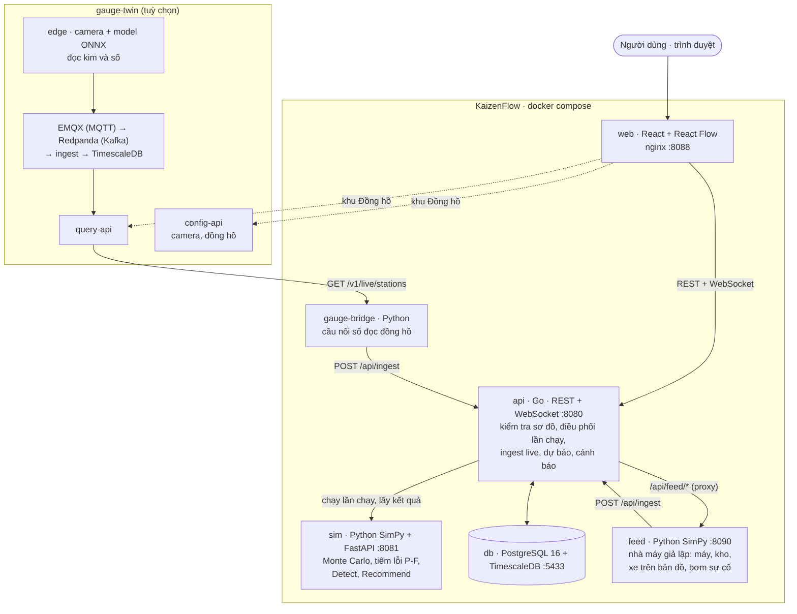

| Thành phần | Công nghệ | Vai trò |
|---|---|---|
| `web` | React, TypeScript, React Flow, Vite; nginx khi chạy bằng Docker | Toàn bộ giao diện: Thiết bị, Sơ đồ, Scenario, Control Room, Đề xuất, So sánh, Báo cáo, Trực tiếp, Bản đồ AGV, Cảnh báo, Đồng hồ |
| `services/api` | Go, chi, pgx; PostgreSQL 16 + TimescaleDB | Lưu thiết bị, mô hình (có phiên bản, bản Publish bất biến), scenario, lần chạy; kiểm tra sơ đồ (18 luật); hợp nhất tham số; điều phối sim; nhận dữ liệu live qua `POST /api/ingest`, ghép nối tín hiệu, WebSocket; dự báo từ trạng thái live và cảnh báo lệch |
| `services/sim` | Python, SimPy, FastAPI | Mô phỏng sự kiện rời rạc chạy Monte Carlo nhiều lần lặp; tiêm lỗi theo đường cong P-F và sinh dữ liệu cảm biến tổng hợp có nhãn; Detect (rủi ro Đỏ, điểm nghẽn); Recommend (sinh phương án, chạy thử từng phương án, xếp hạng) |
| `services/feed` | Python, SimPy, FastAPI | "Nhà máy thật" giả lập cho live twin: chạy engine mô phỏng theo đồng hồ thật × tốc độ, với tham số ẩn lệch khỏi mô hình; xe chạy trên bản đồ AGV/AMR; nhận lệnh bơm sự cố |
| `services/gauge-bridge` | Python | Đọc số đọc đồng hồ ở `query-api` của gauge-twin rồi đẩy vào `/api/ingest` |
| `gauge-twin/` | Go, Python, ONNX; EMQX, Redpanda, TimescaleDB | Edge đọc đồng hồ công nghiệp bằng camera, chỉ gửi số về server. Đặc tả: [`gauge-twin/docs/SPEC.md`](gauge-twin/docs/SPEC.md) |

Hợp đồng dữ liệu giữa API và sim: [`contracts/run.schema.json`](contracts/run.schema.json).

## 3. Luồng dữ liệu

### 3.1 Mô phỏng và đề xuất

Từ danh mục thiết bị đến báo cáo. Mọi lần chạy đều dùng một phiên bản mô hình đã Publish (bất biến), nên chạy lại một scenario cũ vẫn ra đúng số cũ.

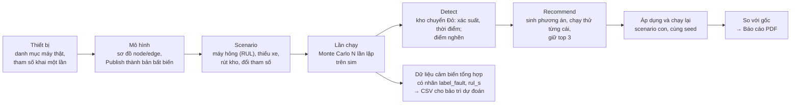

Tham số hiệu lực của mỗi node được hợp nhất theo thứ tự: mặc định của loại node ⊕ tham số thiết bị ⊕ tham số node trên sơ đồ ⊕ `overrides` của scenario.

### 3.2 Vận hành thật (live twin)

Dữ liệu thật đi vào cùng một cổng. Mỗi bản tin `{source, ts, payload}` được ghép nối thành tín hiệu chuẩn của node hay đường nối, nên đổi nguồn (feed giả lập, cầu nối đồng hồ, sau này PLC hay MQTT) chỉ đổi phần ghép nối.

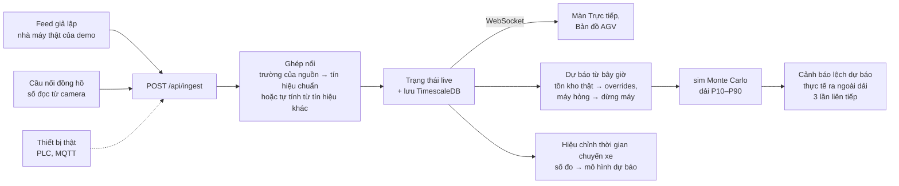

### 3.3 Số đọc đồng hồ từ camera

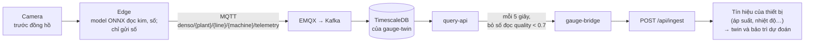

Mã máy của gauge-twin (`machine_id`) chính là mã thiết bị của KaizenFlow, nên ghép tín hiệu một lần ở **Thiết bị → Tín hiệu thiết bị** là mọi mô hình có máy đó đều dùng được.

## 4. Ảnh chụp kết quả

Ảnh chụp từ hệ đang chạy với dữ liệu của `seed_demo.py` và `seed_video_demo.py`.

### Mô phỏng: Control Room, đề xuất, kiểm chứng

| | |
|---|---|
| 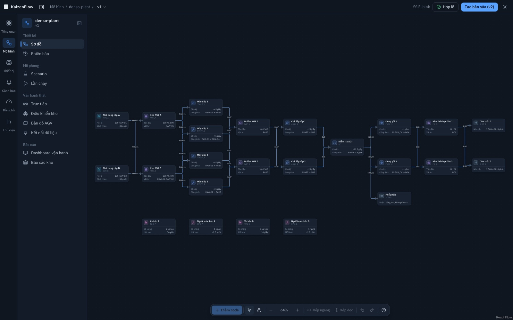 | 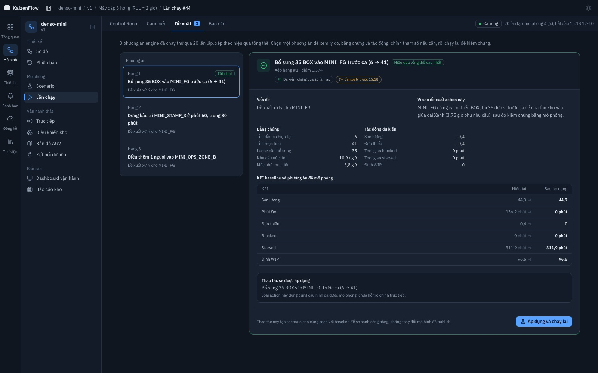 |
| **Sơ đồ**: workflow node/edge của `denso-plant`, 2 kho NVL nuôi 4 máy dập, đội xe kéo và người móc kéo. | **Đề xuất**: 3 phương án đã chạy thử qua 20 lần lặp; phương án 1 đưa số phút Đỏ từ 136 về 0. |
| 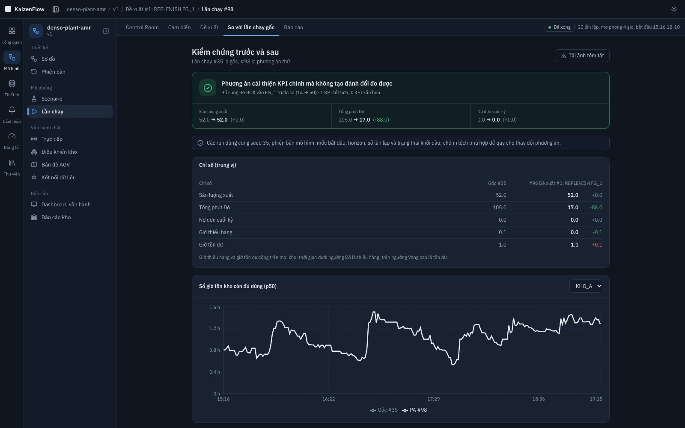 | 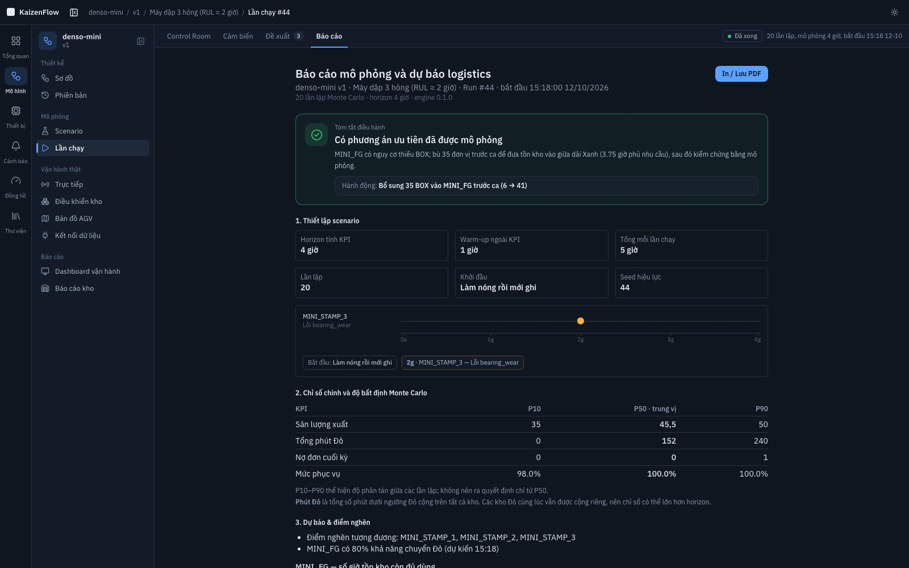 |
| **So với lần chạy gốc**: cùng seed, cùng điểm xuất phát; tổng phút Đỏ 105 → 17, không KPI nào xấu đi. | **Báo cáo**: tóm tắt điều hành, thiết lập scenario, KPI P10–P50–P90, điểm nghẽn; in ra PDF. |
| 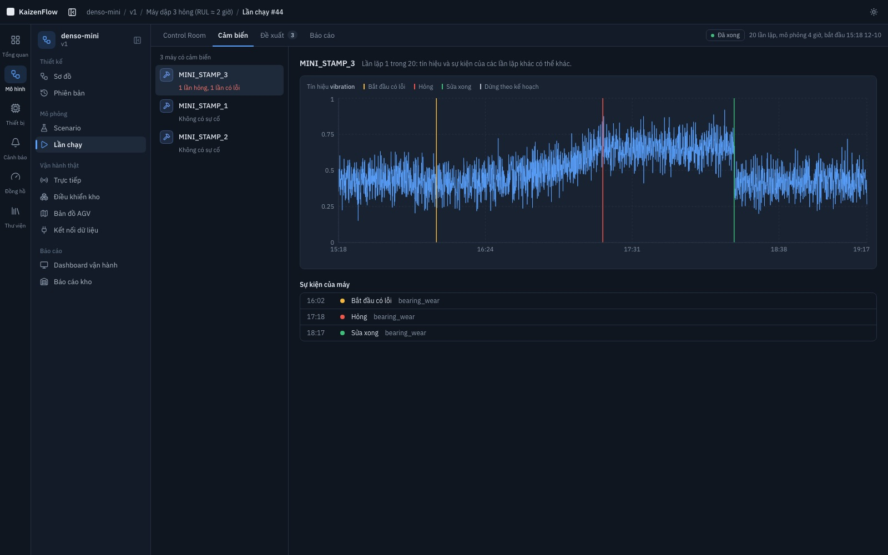 | 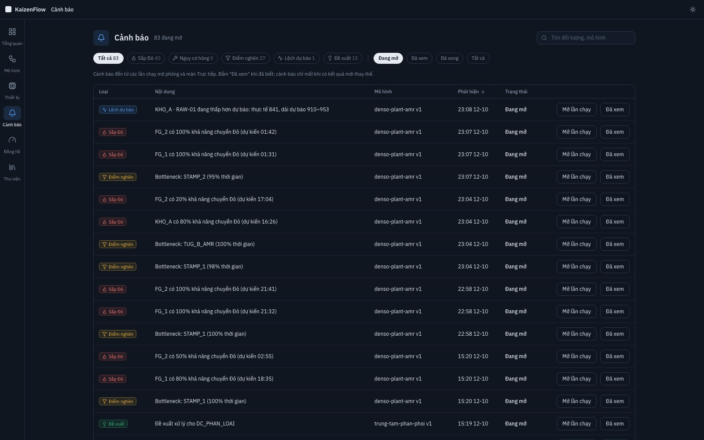 |
| **Cảm biến**: độ rung của máy dập 3 tăng dần trước khi hỏng, có mốc bắt đầu lỗi, hỏng, sửa xong; tải CSV có nhãn. | **Cảnh báo**: gom sắp Đỏ, điểm nghẽn, lệch dự báo và đề xuất từ mọi lần chạy và màn Trực tiếp. |

### Vận hành thật: live twin, bản đồ AGV, đồng hồ

| | |
|---|---|
| 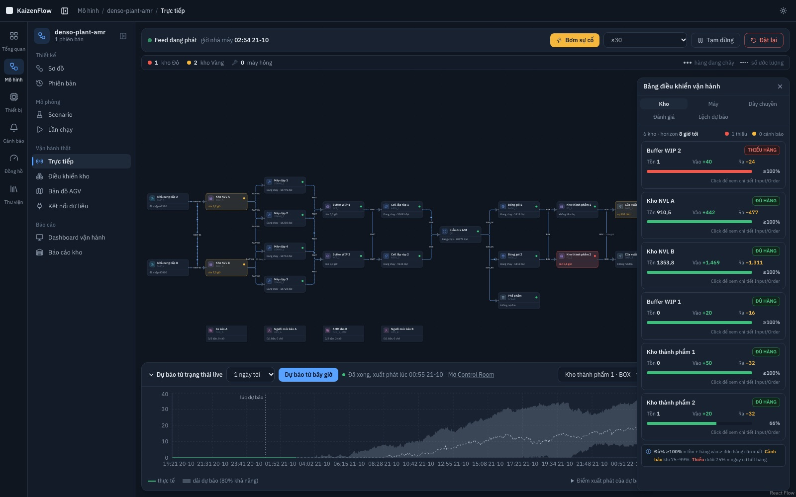 | 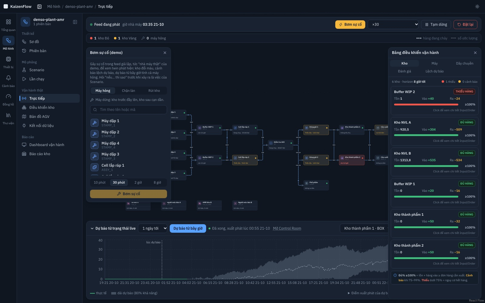 |
| **Trực tiếp**: sơ đồ chạy theo dữ liệu thật, bảng điều khiển vận hành bên phải, dưới là dự báo 1 ngày với dải 80% khả năng. | **Bơm sự cố**: thao tác demo lên feed giả lập (máy hỏng, chặn làn, rút kho) để thấy twin tự phát hiện. |
| 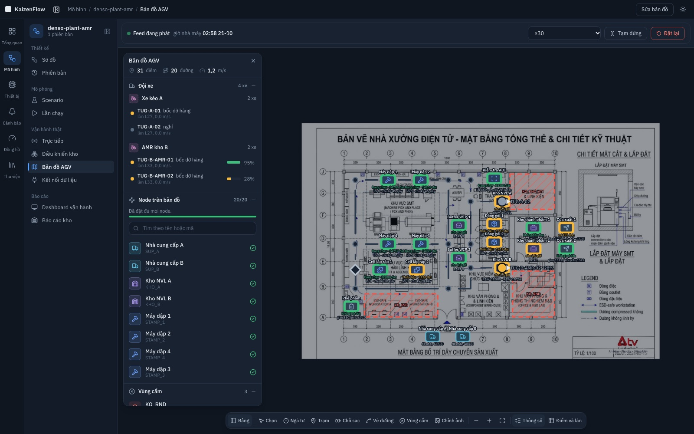 | 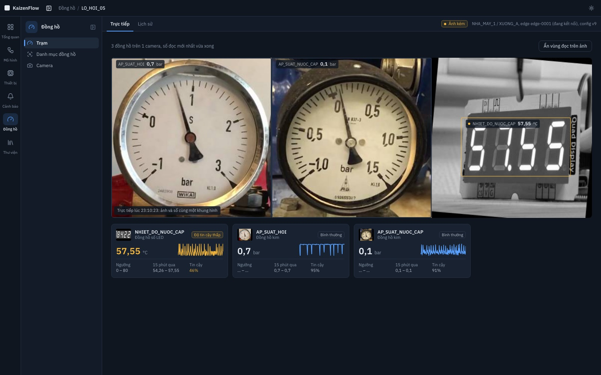 |
| **Bản đồ AGV/AMR**: vẽ trên ảnh mặt bằng; xe kéo và AMR (có % pin) chạy theo làn, node đặt đúng chỗ trên mặt bằng. | **Đồng hồ**: một camera đọc 3 đồng hồ của lò hơi (2 kim, 1 số LED), kèm độ tin cậy. |
| 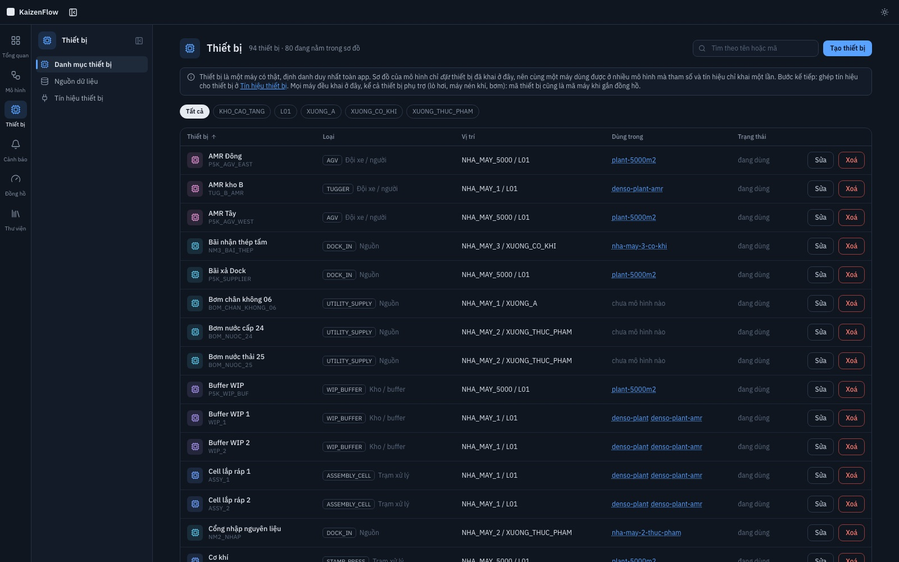 | 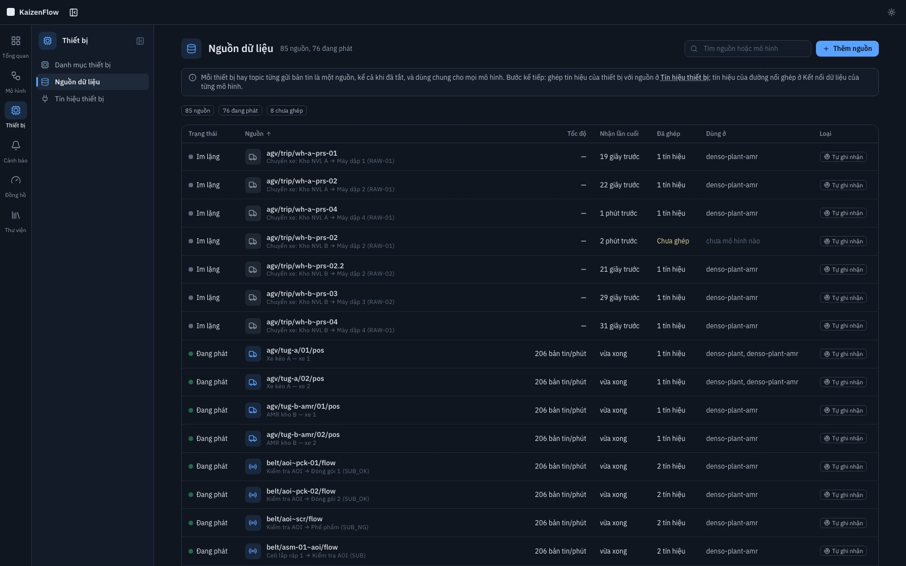 |
| **Thiết bị**: mỗi máy thật khai một lần, dùng được ở nhiều mô hình. | **Nguồn dữ liệu**: mỗi thiết bị hay topic gửi bản tin, trạng thái đang phát và mô hình đang dùng. |

## 5. Chi tiết tính năng

### 5.1 Thiết bị, loại node và mô hình

Ba tầng khác nhau, đừng lẫn:

- **Loại node** (`node_type`, mục Thư viện) là một **lớp trừu tượng**: Máy dập, Kho kệ, Đội xe… Nó định nghĩa vai trò (archetype), schema tham số, cảm biến và chế độ hỏng.
- **Thiết bị** (`asset`, mục Thiết bị) là **một cái máy có thật**, định danh **duy nhất toàn app**. Mã thiết bị cũng là mã node trên mọi sơ đồ, và là `machine_id` khi gắn đồng hồ ở khu Đồng hồ. Tham số thật của máy và ghép nối tín hiệu của nó khai **một lần** ở đây.
- **Mô hình** (`model_version` + `node`) là **một cách bố trí** các thiết bị đó. Một hàng `node` chỉ còn: thuộc version nào, là thiết bị nào, nằm đâu trên sơ đồ, và override gì. Nó không giữ bản sao của loại, vai trò hay tên nữa — khoá ngoại `node.key → asset.key` bắt buộc node phải là một thiết bị đã khai.

Hệ quả:

- **Một thiết bị dùng được ở nhiều mô hình.** `denso-plant` và `denso-plant-amr` là cùng một nhà máy nên dùng chung 23 thiết bị; chỉ đội xe kho B khác (`TUG_B` xe kéo so với `TUG_B_AMR`) vì đó thật sự là hai thiết bị. `denso-mini` và `plant-5000m2` là hai nhà máy ví dụ khác nên có không gian mã riêng (`MINI_`, `P5K_`): trùng mã sẽ bị coi là cùng một cái máy.
- **Tín hiệu ghép một lần.** Ghép nối của một thiết bị lưu với `model_key = ''` và áp cho mọi mô hình có thiết bị đó; số đọc live cũng chỉ lưu **một** bản thay vì một bản cho mỗi mô hình. Ghép nối và số đọc của **đường nối** vẫn theo mô hình, vì một đường nối chỉ tồn tại trong một bố trí.
- **Publish vẫn bất biến.** Bản DRAFT đọc tham số thiết bị trực tiếp (sửa thiết bị là thấy ngay trên sơ đồ đang dựng). Lúc Publish, tham số hiệu lực được **đông cứng** vào `node.params`, nên sau đó sửa thiết bị không làm đổi đầu vào của bản đã khoá — chạy lại scenario cũ vẫn ra đúng số cũ.
- Thứ tự hợp nhất tham số: `node_type.default_params` ⊕ `asset.params` ⊕ `node.params` ⊕ `overrides` của scenario.
- **Thiết bị phụ trợ cũng là thiết bị.** Lò hơi, máy nén khí, bơm, máy phát điện, kho lạnh đều quy về 5 archetype có sẵn: thứ *cấp* một tiện ích (hơi, khí nén, điện, nước lạnh) là `SOURCE` — loại mẫu **Nguồn tiện ích**; thứ *biến đổi* là `PROCESS` — loại mẫu **Máy phụ trợ**. Nhờ vậy mọi máy đang gắn đồng hồ đều khai được vào danh mục, và cảm biến khai trong loại node (áp suất, nhiệt độ, độ rung) là **tín hiệu ghép nối được**, không chỉ để sinh dữ liệu tổng hợp khi mô phỏng — đó là chỗ số đọc đồng hồ cắm vào.
- Gán đồng hồ cho máy ở khu Đồng hồ là **chọn trong danh mục Thiết bị** (hoặc khai thiết bị mới ngay tại đó), không gõ mã tự do: gõ tay sẽ sinh ra một cái máy chỉ khu Đồng hồ biết và số đọc không gắn vào đâu.
- Đổi loại node của một thiết bị đang nằm trong sơ đồ, và xoá thiết bị đang được mô hình dùng, đều bị chặn (`409` kèm danh sách mô hình). Ngừng dùng một máy thì đánh dấu **Ngừng dùng** để giữ lịch sử số liệu.

API: `GET/POST /api/assets`, `GET/PUT/DELETE /api/assets/{key}`, `GET/PUT /api/assets/bindings`, `DELETE /api/assets/bindings/{id}`.

### 5.2 Live twin và bản đồ AGV

Dữ liệu realtime đi vào workflow theo đường: **feed** (bản tin thô của thiết bị) → `POST /api/ingest` → **mapping** (`data_binding`) → tín hiệu chuẩn → trạng thái live + `signal`/`event_log` (`run_id NULL`) → WebSocket → web. Chưa dùng MQTT: bản tin `{source, ts, desc, payload}` độc lập đường truyền nên thay bằng MQTT chỉ đổi lớp nhận..

- **Feed** (`services/feed`): bọc engine sim chạy từng bước theo giờ nhà máy (×1 … ×600). "Thực tế" dùng **tham số ẩn** (chu kỳ máy ×1,10, nhu cầu ×1,08) nên tự lệch khỏi mô hình mà dự báo dùng; đây là dữ liệu giả lập, không phải dữ liệu DENSO. Tên thiết bị khác key node (`STAMP_2` phát ở `plc/prs-02/status`). **Nhiều mô hình chạy cùng lúc**: mỗi mô hình một runner riêng (luồng, giờ nhà máy, tốc độ, sự cố riêng; tối đa `FEED_MAX_MODELS`, mặc định 8), bắt đầu hay dừng mô hình này không đụng tới mô hình kia, và API chỉ áp lô bản tin của feed cho đúng mô hình đó nên hai mô hình dùng chung tên nguồn (ví dụ bản sao) vẫn không lẫn dữ liệu. Điều khiển qua `/api/feed/*` (Go proxy), mọi lệnh nêu rõ mô hình: `POST /start {model, speed}`, `/pause {model}`, `/resume {model}`, `/speed {model, speed}`, `/stop {model}`, `/reset {model}`, `GET /status?model=`, `GET /feeds` (các mô hình đang chạy), `POST /incidents {model, kind, target…}` (`machine_down`, `lane_block`, `stock_drain`), `GET /incidents?model=`, `DELETE /incidents/{id}?model=`.
- **Nguồn dữ liệu**: một nguồn là **một thiết bị/topic ngoài đời**, nên danh mục nguồn là toàn cục và quản lý ở **Thiết bị → Nguồn dữ liệu** (`/assets/sources`; API `GET/POST/DELETE /api/sources`, `POST /api/sources/test`), không nhân bản theo mô hình — `plc/prs-02/status` chỉ có một hàng, một bộ đếm, một lần nhận cuối, trạng thái đang phát gộp từ mọi feed. Cột **Dùng ở** cho biết mô hình nào đang dùng; "đang dùng cho" ghi ghép nối của thiết bị là *dùng chung*, ghép nối đường nối kèm tên mô hình. `GET /api/models/{key}/sources` chỉ còn là bộ lọc cho trang Kết nối dữ liệu (nguồn đã ghép nối, cộng các nguồn chưa ghép ở đâu cả — chính là cái cần ghép tiếp); xoá một mô hình không xoá nguồn. Việc lô bản tin của một feed chỉ áp cho đúng mô hình của nó vẫn do `IngestFor(model, …)` lọc nhóm ghép nối, không phải do bảng nguồn. Danh sách lưu trong DB (còn nguyên khi feed tắt hay API khởi động lại): trạng thái đang phát hay im lặng, tốc độ, lần nhận cuối, số tín hiệu đã ghép, bản tin mẫu dạng cây trường. Thêm nguồn bằng cách dán bản tin mẫu, **Gửi thử** một bản tin qua mọi ghép nối dùng nguồn đó (thiết bị và đường nối ở mọi mô hình; không ghi vào dữ liệu live). Xoá có hỏi trước, đếm và xoá theo ghép nối ở **mọi** mô hình ghi đúng tên nguồn đó; ghép nối dùng ký tự thay thế (`+`, `#`) còn phục vụ nguồn khác nên được giữ.
- **Kết nối dữ liệu** (`/models/{key}/connect`): tách tab **Node**, **Đường nối**, **Tất cả ghép nối** (bảng phẳng, bật/tắt từng cái, thao tác hàng loạt). Mỗi tín hiệu có một trong hai cách lấy giá trị: **từ thiết bị** hoặc **tự tính từ tín hiệu khác** (cộng trừ có hệ số nhân, hoặc trạng thái máy suy từ việc bộ đếm còn tăng); hệ thống gợi ý công thức theo cấu trúc sơ đồ (vd. `moved` = bộ đếm của nguồn trừ `moved` các đường còn lại), kiểm tra hợp lệ trên server trước khi lưu. Nút **Tự suy đường nối** lập công thức `moved` cho mọi đường chưa có dữ liệu, kể cả đường rẽ nhánh (kho nối nhiều máy, nhiều kho cùng cấp một máy): mỗi node một phương trình (bộ đếm máy, số đã giao của đích, số đã nhập về của nguồn, cân bằng kho vào − ra = tồn tăng thêm), bóc dần phương trình còn một ẩn theo độ tin cậy, còn mơ hồ thì chia đều; các dòng chia đều và cân bằng kho gắn nhãn **ước lượng** (nét đứt trên sơ đồ trực tiếp), chỉ dùng để thấy dòng chảy tương đối chứ không phải số đo. Trên số liệu feed của `denso-plant` (coi như không có dữ liệu cạnh nào) cả 29 cạnh suy được, lệch trung bình khoảng 1%, tối đa khoảng 5%; demo có hai nhánh gần cân xứng nên nhà máy chia lệch nhiều sẽ sai hơn ở các nhánh đó, sửa bằng cách chỉnh hệ số trong công thức. `in_transit` của cạnh là tuỳ chọn (không chặn Live). Dải "Live: đủ, Dự báo: thiếu 2, Hiệu chỉnh AGV: thiếu 6" cho biết chức năng nào đã đủ tín hiệu. Chi tiết ghép trường: ghép tín hiệu chuẩn của node/edge (`state`, `level:RAW-01`, `moved`, `trip_s`, `fleet`…) với một trường của một nguồn (đường dẫn `cnt.ok`, `items[sku=RAW-01].qty`; nhân/cộng; bảng đổi `RUN→RUNNING`), có xem trước giá trị; **Gợi ý ghép tự động** so tên mô tả của nguồn với tên node (chỉ tốt khi thiết bị tự mô tả rõ, thiết bị thật thì ghép tay). Mapping thuộc về mô hình, không thuộc version — và với **node** thì thuộc về chính thiết bị, nên ghép một lần là mọi mô hình có thiết bị đó dùng được (xem lại ở Thiết bị → Tín hiệu thiết bị).
- **Trực tiếp** (`/models/{key}/live`): workflow đổi màu/số theo dữ liệu thật (mất tín hiệu quá 15 giây thì xám, không giả vờ còn sống), hạt chảy theo lưu lượng thật; nút **Bơm sự cố** (hổ phách) nằm trên thanh feed giả lập, mở panel riêng bên trái, không nằm trong Bảng điều khiển vận hành — sự cố tác động lên "nhà máy thật" giả lập để twin phải tự phát hiện, khác Scenario là giả thuyết "nếu… thì" trên mô hình; **Dự báo từ trạng thái live** (30 phút đến 1 tuần; tồn kho thật thành `overrides`, máy hỏng thành `planned_stop` của scenario `NOWCAST`; hàng đang chờ trong máy giả định rỗng); đồ thị thực tế chồng dải P10–P90; **cảnh báo lệch dự báo** khi tồn kho thật ra ngoài dải 3 lần kiểm liên tiếp (cách nhau ≥ 5 phút giờ nhà máy), dự báo mới tự đóng cảnh báo cũ.
- **Bản đồ AGV/AMR** (`/models/{key}/map`): đồ thị điểm/đường có sức chứa trên hình học thật (mét). **Mọi đường mặc định hai chiều** (vẽ một lần; mô hình lưu vẫn là hai làn ngược chiều, editor gộp cặp thành một đường); bật "Một chiều" cho tuyến băng từ hay lối hẹp. Đường là đường gấp khúc nên cong/chéo được; trạm gắn với node; xe chạy theo bản đồ, đường tô vàng (đầy chỗ) hoặc đỏ (có xe chờ); chặn đường thì xe AMR đi vòng, hết đường thì chờ.
  - **Hai loại xe theo `kind` của pool** (theo trả lời của BTC DENSO ngày 05/10/2026): **AGV** đi băng từ, tuyến cố định, gặp vật cản thì đứng chờ (quá thời gian chờ quy định thì "người quản lý xử lý": đếm ở `deadlock_breaks`); **AMR** do FMS điều xe rảnh **gần nhất** tới chỗ lấy hàng, đi đường ngắn nhất theo tình hình tắc (chờ hoặc đi vòng), ở lại điểm trả hàng rồi chạy rỗng tới chuyến sau, có **pin** (hao theo quãng đường, xe có hàng hao hơn; thấp thì tự về chỗ sạc gần nhất, đang sạc thì không nhận chuyến). Pin chỉ mô hình hoá khi bản đồ có điểm "Chỗ sạc". Xe kéo, xe nâng giữ cách chạy cũ. Mô hình dự báo (sim) không đổi: hiệu ứng của AMR (chờ, đi vòng, sạc) đi vào dự báo qua **hiệu chỉnh `trip_s`** (chỉ tính chặng có hàng); đổi luật điều phối chỉ thấy ở feed, chưa thấy ở dự báo.
  - **Dữ liệu xe** vào dưới dạng toạ độ (x, y[, hướng `th`]) ở hệ toạ độ của hãng xe; AMR báo thêm tuỳ chọn tốc độ (`v`), pin (`batt`), đích (`dst`), các điểm còn phải qua (`route`): hiện ở danh sách đội xe, nhãn xe trên bản đồ (pin %) và nét đứt tuyến. Ghép nối "Vị trí từng xe" có **khung toạ độ** (dịch, xoay, tỉ lệ, lật Y) đổi sang toạ độ bản đồ, rồi hệ thống **khớp xe vào làn** (làn gần nhất trong 2,5 m, làn ngược chiều/nối tiếp phân biệt bằng hướng; xa hơn là "ngoài đường") để tính mật độ và tắc nghẽn mà xe không cần tự biết làn của mình. Thẻ **Khung toạ độ xe** căn chỉnh khung bằng các cặp (xe đứng yên ↔ điểm đã biết) và báo sai số; ô **Hãng xe báo toạ độ riêng** ở thanh feed giả lập một hệ toạ độ lệch. **Hiệu chỉnh thời gian chuyến**: so `travel` của mô hình với thời gian chuyến đo được (≥ 8 chuyến), áp dụng thành hai scenario cùng seed để so sánh; không sửa version đã Publish.
  - **Vẽ bản đồ từ ảnh mặt bằng.** Tải ảnh PNG/JPEG (thu nhỏ ≤ 2400 px, ≤ 6 MB, lưu ở bảng `agv_map_image`; chỗ đặt và tỉ lệ nằm trong `bg` của bản đồ) làm ảnh nền, **hiệu chuẩn tỉ lệ** bằng hai điểm đã biết khoảng cách (nút **Chỉnh ảnh** để dời, đổi cỡ, xoay ảnh: kéo trong khung, kéo góc, kéo núm tròn, giữ Shift để xoay theo bước 15°, hoặc nhập bề rộng/góc/toạ độ; `bg.rot` là góc xoay quanh tâm ảnh; đổi cỡ bằng tay bỏ dấu đã hiệu chuẩn), rồi bấm **Dò đường**: ảnh → vùng đi được (ngưỡng Otsu, bỏ chữ/nét nhỏ, bỏ phần ngoài tường, loại vùng cấm) → co theo bề rộng xe → làm mảnh (Zhang–Suen) → đồ thị ngã tư/đường, cắt nhánh cụt, gộp ngã rẽ sát nhau, đơn giản hoá. Kết quả là **bản nháp nét đứt** để bạn xem rồi "Thêm vào bản đồ" (đường hai chiều, sức chứa 2 nếu lối rộng ≥ 1,8 m), không tự lưu. Chỉ tốt với ảnh sạch (tường tối, sàn sáng hoặc ngược lại); bản vẽ CAD màu nhiều chữ cần tăng "Bỏ chi tiết" hoặc vẽ tay trên ảnh nền. Chưa thử trên ảnh mặt bằng thật của DENSO.
  - **Vùng cấm** (`keepouts`): đa giác xe không được vào (máy, kệ, tường). Đường cắt vùng hay điểm nằm trong vùng là lỗi (server trả 422, nút Lưu bị khoá kèm danh sách lỗi). Không có vùng giới hạn tốc độ: xe chạy tốc độ cố định và tự giảm khi gặp vật cản.
  - **Đặt node lên bản đồ**: khay "Node trên bản đồ" ở bảng bên (đội xe, người vận hành không có chỗ trên mặt bằng nên không có trong khay); kéo node thả lên bản đồ (hoặc bấm node rồi bấm bản đồ). **Máy không nhất thiết phải nối đường**: chỉ node có xe chở tới (đầu hoặc cuối một đường nối `POOL`, gắn nhãn "xe cần tới") mới tự nối vào đường gần nhất (nối vào đầu đường nếu sát, không thì cắt đường tại hình chiếu); máy nhận hàng qua băng chuyền hay đứng riêng chỉ được đánh dấu vị trí, không thêm đường nào. Node nhiều chỗ đỗ thì đặt nhiều lần và chuyến dùng cặp trạm gần nhau nhất. Công cụ "+ Chỗ sạc" tự nối.
  - **Thông số node trên bản đồ**: dưới mỗi node hiện vài dòng thông số quan trọng, cùng màu với trang Trực tiếp: máy hiện trạng thái, số đạt, số lỗi và chu kỳ; kho hiện số giờ còn dùng và tồn từng vật tư; cửa xuất hiện số đã giao trên nhu cầu và nợ đơn; nguồn hiện số đã nhập. Chưa có dữ liệu live thì hiện thông số cấu hình (chu kỳ, số vị trí, tồn đầu); mất tín hiệu quá 15 giây thì ghi "mất tín hiệu" thay vì số cũ. Nút "Thông số" ở thanh công cụ bật hoặc tắt; bấm một trạm để xem bảng đầy đủ (số đo trực tiếp và thiết lập trong sơ đồ) ở tấm chi tiết.
  - **Kiểm tra liên thông**: đường nối do xe chở mà thiếu trạm, không có đường đi hay không có đường về thì có cảnh báo ngay trên trang bản đồ và trong báo cáo Kiểm tra sơ đồ (`map_station_missing`, `map_unreachable`), vì xe sẽ chờ mãi.
  - Giới hạn: bản đồ tự vẽ có thể tự kẹt vòng (xe kẹt quá 10 phút giờ nhà máy sẽ "chen" qua); mỗi chiều của một đường là một tài nguyên riêng nên hai xe đi ngược chiều không cản nhau (hợp với AMR ở lối rộng, lạc quan với lối hẹp của AGV).
- **Số đọc đồng hồ vào twin** (`services/gauge-bridge`): cầu nối đọc `GET /v1/live/stations` của `query-api` (gauge-twin) rồi `POST /api/ingest` như một nguồn dữ liệu bình thường, mỗi 5 giây (`GAUGE_BRIDGE_INTERVAL_S`). Chiều **kéo** chứ không phải đẩy, vì gauge-twin là hệ của nhà máy chạy độc lập (stack riêng, DB riêng, edge ngoài hiện trường) và không được phụ thuộc KaizenFlow để hoạt động — KaizenFlow sập thì khu Đồng hồ vẫn đọc đồng hồ như cũ, và gauge-twin không phải sửa một dòng nào.
  - Tên nguồn là chính topic edge đã publish (`denso/{plant}/{line}/{machine}/telemetry`) nên trang Nguồn dữ liệu hiện đúng cái có thật ngoài hiện trường. Một bản tin cho một máy, các đồng hồ nằm trong `payload.gauges`, ghép nối trỏ tới `gauges.<mã đồng hồ>.value`.
  - Bỏ số đọc `quality < 0.7` (cùng ngưỡng rollup `gauge_1m` của gauge-twin, chỗ lấy dữ liệu cho Predict): ảnh mờ hay kim bị che không được đi vào twin như một số đo. Chỉ gửi số đọc **mới** theo mốc thời gian, vì twin tính tốc độ theo chuỗi thời gian nên bơm lại cùng giá trị sẽ làm lệch.
  - Không gửi kèm `model`: đây là dữ liệu **thật** nên áp cho mọi mô hình có ghép nối khớp (khác feed giả lập, mỗi mô hình một runner nên phải nói rõ mô hình).
  - Đường đi đủ: camera → edge → MQTT → Kafka → TimescaleDB → `query-api` → cầu nối → `/api/ingest` → ghép nối thiết bị → trạng thái live. Ghép một lần ở **Tín hiệu thiết bị** là mọi mô hình có thiết bị đó dùng được.
- Dự báo dài dùng lấy mẫu thưa (≤ 400 điểm), không ghi sự kiện/cảm biến thô và không chạy đề xuất; 1 tuần × 20 lần lặp mất khoảng 20 giây với `SIM_WORKERS=6` (đặt trong `docker-compose.yml`).

### 5.3 Kiểm tra sơ đồ và quản lý đối tượng

- **Kiểm tra sơ đồ** (nút cạnh Lưu ở Editor, `POST /api/versions/{id}/check`): 18 luật bằng tiếng Việt (thiếu Nguồn/Đích, vật tư không có trong Thư viện kèm gợi ý "Có phải ý bạn là RAW-01?", công thức thiếu đường cấp, vòng không có Kho, đường nối trùng, node cô lập, Kho chưa khai báo vật tư…) và danh sách **thông số sẽ dùng giá trị thay thế** (chu kỳ lấy mặc định loại node, hoặc mô phỏng âm thầm dùng 1 giây nếu không đâu có; xe đến ngay nếu chưa đặt thời gian đi). **Lưu** kiểm tra trước: có lỗi thì hỏi "Quay lại sửa" hay "Vẫn lưu nháp"; **Publish** chặn cứng khi còn lỗi. Kéo dây nối node với chính nó bị chặn kèm lý do.
- **Ô chọn thay cho ô gõ**: vật tư trong mọi form tham số chọn từ Thư viện (tạo mới ngay trong ô), nguồn và trường trong hộp Ghép nối, đơn vị, cảm biến và chế độ hỏng của loại node (bảng thay cho JSON), mô hình có thể sao từ mô hình sẵn có.
- **Màu nút**: xanh dương là hành động chính (Lưu, Tạo, Chạy), xanh lá là đưa vào dùng (Publish, Bắt đầu phát), đỏ viền là phá huỷ (Xoá, Đặt lại; đỏ đặc chỉ ở bước xác nhận), hổ phách là thao tác gây rối của demo (Bơm sự cố, Chặn làn). Tương phản chữ/nền ≥ 4,5:1 cả hai giao diện (có test đọc thẳng `index.css`).
- **Trang Cảnh báo** (`/alerts`) gom mọi loại cảnh báo; đầu trang Phiên bản có danh sách **Thiết lập** (vật tư → sơ đồ → Publish → nguồn → ghép nối → bản đồ → chạy trực tiếp) với bước kế tiếp; tab của mô hình gom thành Thiết kế, Mô phỏng, Vận hành thật.

### 5.4 Sửa và xoá

- `DELETE /api/models/{key}`, `/api/versions/{id}`, `/api/scenarios/{id}`: nếu còn dữ liệu phụ thuộc thì trả `409` kèm `{"impact": {"scenarios": 3, "runs": 12}}`; gọi lại với `?cascade=true` để xoá dây chuyền (một transaction).
- Có lần chạy `QUEUED`/`RUNNING` trong phạm vi thì luôn `409`, kể cả khi `cascade=true`.
- Thiết bị: mã bất biến (đổi mã là một thiết bị khác). Loại node của thiết bị bị khoá khi nó đang nằm trong sơ đồ; xoá bị khoá khi còn mô hình dùng. Loại node nào cũng như nhau: 16 loại mẫu (Máy dập, Kho kệ, và **Nguồn tiện ích** / **Máy phụ trợ** cho thiết bị phụ trợ của nhà máy) chỉ được nạp một lần khi bảng còn trống rồi là dữ liệu của bạn (sửa, xoá, đổi icon tự do; API khởi động lại không nạp đè hay nạp lại). Loại node bị khoá sửa và xoá khi có phiên bản đã Publish dùng; đang được phiên bản nháp dùng thì sửa được nhưng chưa xoá được. Vật tư: mã bất biến, đơn vị và xoá bị khoá khi đang dùng (kể cả tham chiếu bằng chuỗi mã trong tham số node).
- Scenario chỉ sửa được khi chưa có lần chạy; dùng `POST /api/scenarios/{id}/clone` để thử thông số khác.

### 5.5 Giao diện web

- `cd web && npm install && npm run dev` (mặc định `http://localhost:5173`, API ở `VITE_API_URL`).
- Theme tối là mặc định; nút mặt trời/mặt trăng ở góc phải header đổi sang sáng và nhớ lựa chọn (`localStorage`, khoá `kf-theme`). Trang Báo cáo và bản in luôn dùng theme sáng.
- Editor (sơ đồ): kéo trên vùng trống để chọn nhiều node (Shift/Ctrl/⌘ + bấm để thêm), Space hoặc chuột giữa hoặc công cụ Bàn tay (`H`) để kéo canvas, `Ctrl/⌘ + C/V/D` sao chép, dán, nhân đôi (dán được sang phiên bản khác trong cùng tab), `Ctrl/⌘ + Z / Shift+Z` hoàn tác và làm lại nhiều bước, `Ctrl/⌘ + S` lưu, `?` xem bảng phím tắt. Thêm node: nút "Thêm node" (danh sách có ô tìm), `Tab` hoặc `/` hoặc bấm đúp chỗ trống (ô tìm tại con trỏ), hoặc thả dây từ một chấm ra chỗ trống để thêm và tự nối. Chọn loại node xong thì hộp **Đặt … lên sơ đồ** bắt chọn **thiết bị** trong danh mục (hoặc khai thiết bị mới ngay tại đó): node không còn tự sinh mã, mã node là mã thiết bị. Thanh công cụ ngang ở đáy gộp thu phóng, "Xếp ngang/dọc" (tự sắp xếp, chỉ bản DRAFT), hoàn tác, khoá sơ đồ. Hướng sơ đồ suy ra từ vị trí node, không lưu riêng. Rời trang khi chưa lưu thì trình duyệt hỏi lại (chuyển trang trong app thì chưa có cảnh báo).
- Control Room: hạt chạy trên edge cho thấy hàng đang chảy. Số hạt tỉ lệ với lưu lượng thật (chỉ số `moved` của sim, trung bình 10 mốc gần nhất, so với mức bận điển hình của run); tốc độ theo thời gian di chuyển của edge (30 giây thật ≈ 1 giây trên màn hình). Replay chạy nhanh hơn thời gian thật hàng trăm lần nên không thể chảy 1:1. Run tạo trước khi có `moved` dùng `in_transit`.
- Nếu trang hiện chữ trần không có style (Tailwind không sinh class do cache Vite lỗi thời): dừng `npm run dev`, xoá `web/node_modules/.vite`, chạy lại.
- Phím tắt ở Control Room: `←` `→` bước 1 mốc, `Shift`+`←` `→` bước 10 mốc, `Space` phát/dừng, `Home` `End`, `F` chế độ tập trung, `Esc` thoát.
- Điều hướng: thanh chính bên trái gồm Tổng quan, Mô hình, **Thiết bị**, Cảnh báo, Đồng hồ, Thư viện. Mục Thiết bị ngang hàng với Mô hình (một thiết bị không thuộc mô hình nào) và có ba trang: **Danh mục thiết bị**, **Nguồn dữ liệu** và **Tín hiệu thiết bị** (khai máy, thấy nguồn, ghép). Vào một mô hình (hoặc một lần chạy, thư viện) thì **panel phụ** cạnh thanh chính liệt kê các trang theo nhóm Thiết kế (Sơ đồ, Phiên bản), Mô phỏng (Scenario, Lần chạy), Vận hành thật (Trực tiếp, Điều khiển kho, Bản đồ AGV, Kết nối dữ liệu). Nguồn dữ liệu là toàn cục nên nằm ở mục Thiết bị; địa chỉ cũ `/models/{key}/sources` chuyển về `/assets/sources`. Lần chạy luôn nằm trong mô hình nên không có mục riêng trên thanh chính (trang "Mọi lần chạy" đã bỏ; `/runs` chuyển về danh sách Mô hình). Ở trang thường panel phụ nằm cố định và thu gọn được (nhớ lựa chọn); ở trang sơ đồ (Sơ đồ, Trực tiếp, Bản đồ AGV, Control Room) nó ẩn để sơ đồ rộng nhất, bấm nút panel trên header hoặc phím `[` để mở nổi, chọn trang hoặc Esc là đóng. Mỗi loại object có bảng, trang chi tiết và các thao tác tạo, sửa, nhân bản, xoá theo quy tắc bất biến bên dưới.
- Font IBM Plex Sans được tự host (`web/src/fonts.css`, chỉ hai subset latin và vietnamese) nên demo không cần mạng.

## 6. Phát triển và kiểm thử

Chạy từng dịch vụ ngoài Docker để sửa code (web ở `http://localhost:5173` bằng Vite dev server): xem [SETUP.md](SETUP.md). Pull `main` về mà cần làm thêm gì (migration, service mới, cách làm cũ bị vỡ): xem [UPGRADE.md](UPGRADE.md).

```bash
cd services/sim && pytest
cd services/feed && ../sim/.venv/bin/python -m pytest
cd services/api && go test ./...      # cần `docker compose up -d db`
cd web && npx vitest run
```

Cấu trúc repo:

| Thư mục | Nội dung |
|---|---|
| `services/api` | API Go, migration SQL (`migrations/`), kiểm tra sơ đồ, live twin |
| `services/sim` | Engine mô phỏng SimPy, Monte Carlo, Detect, Recommend |
| `services/feed` | Bộ phát dữ liệu giả lập cho live twin |
| `services/gauge-bridge` | Cầu nối số đọc đồng hồ vào twin |
| `web` | Giao diện React (`Dockerfile` + `nginx.conf` để chạy bằng Docker) |
| `contracts` | Hợp đồng dữ liệu API ↔ sim |
| `scripts` | Script nạp dữ liệu demo |
| `assets` | Ảnh mặt bằng mẫu cho bản đồ AGV |
| `screenshots` | Ảnh chụp trong README |
| `gauge-twin` | Hệ đọc đồng hồ bằng camera (edge, server, model) |
